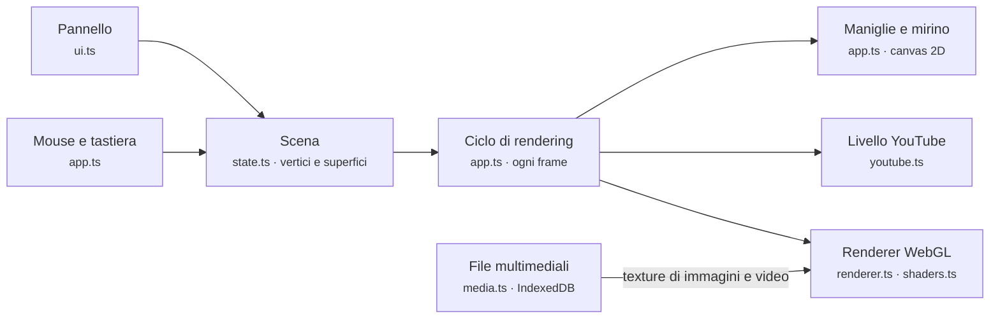

# Projection Mapper – Documentazione

Aggiornata al 1° novembre 2026

## Indice

1. [Introduzione](#introduzione)
2. [Requisiti e installazione](#requisiti-e-installazione)
3. [Primo utilizzo con il proiettore](#primo-utilizzo-con-il-proiettore)
4. [Modifica delle superfici](#modifica-delle-superfici)
5. [Il pannello di controllo](#il-pannello-di-controllo)
6. [Effetti](#effetti)
7. [Immagini, video e YouTube](#immagini-video-e-youtube)
8. [Comandi da tastiera e mouse](#comandi-da-tastiera-e-mouse)
9. [Salvataggio, esportazione e importazione](#salvataggio-esportazione-e-importazione)
10. [Consigli pratici per un buon mapping](#consigli-pratici-per-un-buon-mapping)
11. [Risoluzione dei problemi](#risoluzione-dei-problemi)
12. [Architettura tecnica](#architettura-tecnica)

## Introduzione

Projection Mapper è un'applicazione web che proietta immagini su superfici inclinate rispetto al proiettore, correggendo la prospettiva in tempo reale. L'esempio tipico è una scatola vista a 3/4: ognuna delle tre facce visibili riceve il proprio contenuto e appare dritta e proporzionata, non deformata.

Con l'applicazione puoi:

- disegnare una o più superfici (quadrilateri) e allinearle agli spigoli reali dell'oggetto;
- assegnare a ogni superficie uno dei 15 effetti: animazioni generate, immagini, video locali o video YouTube;
- sincronizzare gli effetti tra le facce con un ritardo, per ottenere effetti a cascata stile concerto;
- nascondere l'interfaccia e usare l'uscita pulita durante lo spettacolo.

L'app gira interamente nel browser, sul computer collegato al proiettore. Non serve un server esterno né una connessione internet, salvo per i video YouTube.

## Requisiti e installazione

Servono Node.js 20 o successivo e un browser con WebGL2 (Chrome, Edge o Firefox recenti). Il progetto è stato sviluppato con Node 24, Vite 8 e TypeScript 7.

| Comando | Cosa fa |
| --- | --- |
| `npm install` | Installa le dipendenze (solo la prima volta) |
| `npm run dev` | Avvia l'app su http://localhost:5173 e apre il browser |
| `npm run build` | Controlla i tipi e crea la versione statica nella cartella `dist/` |
| `npm run preview` | Serve la versione di `dist/` per provarla |

La cartella `dist/` si può copiare su qualsiasi server web statico. Va servita via HTTP: aprendo `index.html` direttamente dal disco il browser blocca i moduli JavaScript.

## Primo utilizzo con il proiettore

Dal collegamento allo spettacolo servono sei passaggi; l'allineamento della scatola è quello che richiede più cura.

1. **Collega il proiettore** come secondo schermo in modalità *Estendi* (su Windows: tasto Win+P → Estendi). Disattiva la correzione trapezoidale (keystone) del proiettore: la correzione la fa l'app.
2. **Avvia l'app** con `npm run dev`, trascina la finestra del browser sullo schermo del proiettore e premi **F** per lo schermo intero.
3. **Posiziona la scatola** in modo che il fascio di luce copra tutte e tre le facce visibili. Al primo avvio l'app mostra già un cubo 3/4 con la griglia di calibrazione.
4. **Allinea gli angoli**: trascina ogni maniglia gialla sullo spigolo reale corrispondente. Trascinando l'interno di una faccia sposti tutto il cubo; con le frecce rifinisci di 1 pixel alla volta.
5. **Controlla la griglia**: con l'allineamento corretto le linee della griglia sono dritte e il cerchio di ogni faccia appare rotondo sulla scatola.
6. **Scegli gli effetti** per ogni faccia, poi premi **H** per nascondere interfaccia, maniglie e cursore. Premi di nuovo **H** per tornare alla modifica.

## Modifica delle superfici

Ogni superficie è un poligono: parte come quadrilatero e puoi aggiungere altri vertici fino a 32. I vertici possono essere condivisi tra più superfici, così uno spigolo comune resta sempre unito.

**Vertici.** Le maniglie rotonde sono vertici di una sola superficie, quelle a rombo sono condivise; le maniglie più piccole sono vertici di contorno (vedi sotto). Mentre trascini un vertice compare un mirino giallo a tutto schermo che aiuta ad allinearlo agli spigoli reali.

**Aggancio.** Se rilasci un vertice a meno di 12 pixel da un altro, i due si uniscono (cerchio verde durante il trascinamento). Tieni premuto Shift per non agganciare. Per separare un vertice condiviso selezionalo e premi **D**: ogni superficie riceve la propria copia.

**Vertici aggiuntivi.** Fai doppio clic su un lato per aggiungere un vertice in quel punto, oppure premi **I** (o il pulsante *+ Vertice*) per aggiungerlo a metà del lato che parte dal vertice selezionato. Se il lato è condiviso con un'altra superficie, il vertice viene aggiunto a entrambe e lo spigolo resta unito. **X** (o *Rimuovi vertice*) toglie il vertice selezionato.

I quattro vertici iniziali restano gli **angoli prospettici**: definiscono la prospettiva del contenuto e non si possono rimuovere. Gli altri sono **vertici di contorno** e cambiano solo la forma: spostati verso l'interno ritagliano il contenuto, verso l'esterno lo estendono con la stessa prospettiva. Con la superficie selezionata il quadrilatero degli angoli è indicato da una linea gialla tratteggiata. Il poligono può essere concavo (per esempio a forma di L). Gli effetti che seguono i bordi (bordi al neon, cornice della griglia, sfumatura) usano il contorno del poligono; immagini e video fuori dal quadrilatero degli angoli restano neri.

**Forme inscritte.** Dal menu *Forma* del pannello puoi ritagliare il contenuto con una forma inscritta nel quadrilatero dei quattro angoli prospettici, utile per disegnare sagome particolari (un oblò, un logo, una stella):

- **Contorno del poligono** (predefinita): il contenuto riempie tutto il poligono.
- **Ellisse inscritta**: il cerchio che tocca i quattro lati della faccia. Sulla superficie reale appare come un cerchio, o un'ellisse se la faccia è rettangolare; in proiezione segue la prospettiva.
- **Mano libera**: scegliendola parte la modalità disegno (in alto compare l'avviso in azzurro). Tieni premuto il mouse e traccia il contorno sull'area di proiezione; al rilascio la forma si chiude da sola. Il tracciato viene semplificato a un massimo di 96 punti. *Ridisegna forma* lo sostituisce, Esc annulla il disegno.

La forma è salvata nelle coordinate della faccia: spostando gli angoli si deforma con la prospettiva e resta inscritta. Sull'area di proiezione è indicata da una linea azzurra. Il poligono resta comunque il limite esterno, e la sfumatura dei bordi e gli effetti che seguono i bordi (bordi al neon, cornice della griglia) seguono la forma.

**Spostamento.** Trascinando l'interno di una superficie si sposta tutto il gruppo collegato, per esempio l'intero cubo. Con Alt premuto si sposta solo quella superficie.

**Precisione.** Le frecce spostano il vertice selezionato di 1 pixel (Shift: 10 pixel). Se nessun vertice è selezionato spostano il gruppo. **V** passa al vertice successivo della superficie selezionata, compresi i vertici di contorno.

**Superfici non valide.** Se i quattro angoli prospettici formano un quadrilatero incrociato o concavo, oppure se i lati del poligono si incrociano, la superficie viene bordata di rosso con la scritta "non valida" e non viene disegnata finché non la correggi.

**Annulla.** Ctrl+Z annulla fino a 100 modifiche: trascinamenti, aggiunte, eliminazioni e cambi di effetto.

## Il pannello di controllo

Il pannello sta sul lato destro e ha quattro sezioni; si nasconde con **H** o con il pulsante *Nascondi*.

| Sezione | Controlli |
| --- | --- |
| Scena | *+ Superficie* (nuovo quadrilatero al centro), *+ Cubo 3/4* (tre facce collegate), *Annulla*, *Esporta*, *Importa*, *Svuota* |
| Uscita | *Luminosità* generale, *Griglia su tutto* (calibrazione), *Blackout*, *Schermo intero*, *Modalità show* |
| Superfici | Elenco delle superfici: la casella le mostra o nasconde, ▲ ▼ cambiano l'ordine di disegno (quelle in alto stanno sopra), un clic seleziona |
| Superficie selezionata | Nome, effetto e parametri della superficie scelta (vedi sotto) |

I parametri della superficie selezionata:

| Parametro | Significato |
| --- | --- |
| Effetto | Il contenuto proiettato (vedi la sezione Effetti) |
| Colori | Colore principale e secondario dell'effetto |
| Velocità | Da 0 (fermo) a 4; 1 è la velocità normale |
| Scala | Dimensione del motivo, da 0,1 a 4 |
| Ritardo | Secondi di sfasamento rispetto alle altre superfici, da 0 a 5 |
| Rotazione / Specchia | Ruota il contenuto a passi di 90° o lo specchia in orizzontale |
| Opacità | Trasparenza della superficie |
| Sfumatura bordi | Ammorbidisce i bordi, utile per nascondere piccoli errori di allineamento |
| Proporzioni L/A | Rapporto larghezza/altezza della faccia reale (1 per un cubo); evita che cerchi e griglie risultino schiacciati |
| Forma | Contorno del poligono, ellisse inscritta o forma a mano libera (*Disegna forma* / *Ridisegna forma*) |

Due pulsanti agiscono su tutta la scena: *Applica a tutte* copia effetto e parametri sulle altre superfici mantenendo i loro ritardi; *Ritardi a cascata* assegna ritardi crescenti di 0,4 secondi nell'ordine delle superfici.

## Effetti

Gli effetti sono 15: 12 animazioni generate dalla scheda video, uno per immagini e video locali, uno per YouTube e la griglia di calibrazione. Tutti seguono la prospettiva della faccia; colori, velocità, scala e ritardo si regolano per superficie.

| Effetto | Descrizione | Uso tipico |
| --- | --- | --- |
| Griglia di calibrazione | Griglia, diagonali, cerchio e freccia "su" | Allineamento e orientamento |
| Colore pieno | Superficie di un solo colore | Illuminare una faccia, basi |
| Gradiente animato | Sfumatura tra i due colori che scorre | Sfondo morbido |
| Strisce in movimento | Strisce diagonali che scorrono | Ritmo, movimento |
| Scacchiera | Scacchi che scorrono in orizzontale | Effetto grafico |
| Plasma | Macchie di colore fluide | Atmosfera psichedelica |
| Bordi al neon | Contorno luminoso pulsante con una luce che gira | Il classico effetto "scatola al neon" |
| Scansione | Barra luminosa che scende | Con *Ritardi a cascata* passa da una faccia all'altra |
| Cerchi concentrici | Onde circolari che si espandono | Impulsi a tempo |
| Glitch | Righe che saltano e disturbi | Effetto digitale, transizioni |
| Riempimento liquido | Livello di liquido che sale e scende con onde | Illusione di scatola che si riempie |
| Tunnel (scatola cava) | Quadrati concentrici che sprofondano verso il centro | Illusione di profondità dentro la faccia |
| Immagine / video | File caricato dal computer | Contenuti propri |
| Strobo | Lampeggio acceso/spento | Picchi musicali, con moderazione |
| Video YouTube | Video da un link YouTube | Contenuti online |

Il tasto **G** (o *Griglia su tutto*) mostra temporaneamente la griglia su tutte le superfici senza cambiare gli effetti impostati. Lo strobo può dare fastidio alle persone fotosensibili: usalo a bassa velocità e per brevi momenti.

## Immagini, video e YouTube

Per uno spettacolo conviene usare file locali: funzionano senza internet, supportano tutte le opzioni e non mostrano scritte. YouTube è comodo per provare, ma ha dei limiti.

### Immagini e video locali

1. Seleziona la superficie e scegli l'effetto **Immagine / video**.
2. Premi *Carica immagine/video…* e scegli il file (JPG, PNG, WebP, GIF, MP4, WebM).
3. Scegli l'*Adattamento*: **Riempi** copre tutta la faccia ritagliando i bordi in eccesso; **Deforma** stira il contenuto sulla faccia.

I video partono in automatico, muti e in loop. I file vengono salvati nel browser (IndexedDB) e restano disponibili dopo un ricaricamento della pagina.

### Video YouTube

1. Scegli l'effetto **Video YouTube**.
2. Incolla il link nel campo *Link*. Sono riconosciuti `youtube.com/watch?v=…`, `youtu.be/…`, shorts, live, embed e il solo ID di 11 caratteri; il tempo di inizio (`?t=90`, `?t=1m30s`) viene rispettato.
3. Sotto il campo compare l'ID del video se il link è valido. Spunta *Audio* per attivare il suono.

Limiti di YouTube:

- YouTube non permette di leggere i pixel del suo player, quindi il video non passa dallo shader ma viene deformato con una trasformazione CSS. Per questo sta sempre sopra gli effetti generati e non supporta la sfumatura dei bordi. Le forme inscritte funzionano (ritaglio CSS), ma con una forma attiva il ritaglio segue solo la forma e non più il poligono.
- Il video parte muto perché i browser bloccano l'avvio automatico con l'audio.
- All'avvio YouTube mostra per qualche secondo titolo e logo.
- Serve una connessione internet, e i video con incorporamento disattivato dal proprietario non partono.

## Comandi da tastiera e mouse

I tasti funzionano quando il cursore non è in un campo di testo; Esc esce dal campo.

| Comando | Azione |
| --- | --- |
| Trascina un angolo | Sposta il vertice (Shift: senza aggancio) |
| Trascina l'interno | Sposta il gruppo collegato (Alt: solo la superficie) |
| Doppio clic sul vuoto | Nuova superficie in quel punto |
| Doppio clic su un lato | Aggiunge un vertice in quel punto |
| Clic sul vuoto | Deseleziona |
| H | Mostra/nascondi interfaccia (modalità show) |
| F | Schermo intero |
| B | Blackout |
| G | Griglia di calibrazione su tutte le superfici |
| N | Nuova superficie al centro |
| Tab / Shift+Tab | Superficie successiva / precedente |
| V | Vertice successivo della superficie selezionata |
| Frecce | Sposta vertice o gruppo di 1 px (Shift: 10 px) |
| I | Aggiunge un vertice a metà del lato dopo il vertice selezionato |
| X | Rimuove il vertice selezionato (non i 4 angoli) |
| D | Stacca il vertice condiviso selezionato |
| Trascina in modalità disegno | Traccia la forma a mano libera (Esc annulla) |
| Canc | Elimina la superficie selezionata |
| Esc | Deseleziona il vertice |
| Ctrl+Z | Annulla |

## Salvataggio, esportazione e importazione

La scena si salva da sola nel browser circa 0,3 secondi dopo ogni modifica; alla riapertura ritrovi tutto com'era.

| Cosa | Dove viene salvato | Incluso nell'esportazione |
| --- | --- | --- |
| Superfici, vertici, forme, effetti, parametri | localStorage del browser | Sì |
| Link YouTube | localStorage del browser | Sì |
| Immagini e video caricati | IndexedDB del browser | No |

*Esporta* scarica il file `mapping.json` con la configurazione; *Importa* lo ricarica. Serve per fare copie di sicurezza o portare un allineamento su un altro computer. Dopo l'importazione su un altro computer le superfici con file mancanti mostrano l'avviso "non trovato: ricaricalo".

Il salvataggio è legato a browser e indirizzo: aprendo l'app con un altro browser, o su una porta diversa da 5173, la scena riparte da zero. Anche cancellare i dati di navigazione elimina la scena.

## Consigli pratici per un buon mapping

La qualità del risultato dipende più dalla preparazione fisica che dagli effetti scelti.

- **Superfici chiare e opache**: una scatola bianca o grigio chiaro rende molto meglio di una marrone o lucida.
- **Stanza buia**: anche un proiettore potente perde contrasto con la luce ambiente.
- **Proiettore e scatola fermi**: anche un piccolo urto rovina l'allineamento. Fissa entrambi prima di calibrare.
- **Proiettore più in alto della scatola e leggermente di lato**: così le tre facce ricevono luce in modo più uniforme.
- **Messa a fuoco a metà profondità**: le facce sono a distanze diverse; metti a fuoco sullo spigolo centrale.
- **Calibra con la griglia**, poi verifica a occhio dal punto in cui guarderà il pubblico.
- **Nero = niente luce**: tutto ciò che sta fuori dalle superfici resta nero, quindi il muro dietro non si illumina. Contenuti con molto nero rendono più "magico" l'effetto.
- **Gioca con i ritardi**: lo stesso effetto con ritardi diversi sulle facce (Scansione, Bordi al neon, Cerchi) dà l'impressione che la luce si muova lungo l'oggetto.
- **Esporta la configurazione** quando l'allineamento è buono, così puoi ripristinarla in un attimo.

## Risoluzione dei problemi

| Problema | Causa probabile | Soluzione |
| --- | --- | --- |
| Schermata con "Errore di avvio: WebGL2 non disponibile" | Browser vecchio o accelerazione hardware disattivata | Aggiorna il browser; in Chrome/Edge attiva *Impostazioni → Sistema → Usa accelerazione grafica* |
| Una superficie non compare ed è bordata di rosso | Angoli prospettici incrociati o concavi, oppure lati del poligono che si incrociano | Riporta i vertici in ordine, senza linee che si incrociano |
| La griglia è storta sulla scatola | Angoli non allineati o keystone del proiettore attivo | Disattiva il keystone e riallinea con le frecce |
| Cerchi schiacciati sulla faccia | *Proporzioni L/A* diverse dalla faccia reale | Imposta il rapporto larghezza/altezza reale |
| Il video locale non parte | Formato non supportato dal browser | Converti in MP4 (H.264) o WebM |
| "Non trovato: ricaricalo" | File non presente in questo browser | Ricarica il file dalla superficie |
| Il video YouTube resta nero | Incorporamento disattivato, nessuna connessione o caricamento in corso | Attendi qualche secondo, verifica la connessione o prova un altro video |
| L'audio YouTube non si sente | Il browser blocca l'audio senza un'interazione | Spunta *Audio* dopo aver cliccato nella pagina |
| La scena è sparita | Altro browser, altra porta o dati di navigazione cancellati | Importa l'ultimo `mapping.json` esportato |
| I tasti non rispondono | Il cursore è in un campo del pannello | Premi Esc o clicca sull'area di proiezione |

## Architettura tecnica

L'app è scritta in TypeScript con Vite e WebGL2, senza framework per l'interfaccia: il lavoro principale è il rendering su GPU e il pannello è semplice DOM.



Pannello e input modificano la scena; a ogni frame il ciclo di rendering la disegna su tre livelli sovrapposti. Dal basso: canvas WebGL, player YouTube, maniglie; il pannello sta sopra a tutto.

### La correzione prospettica

Ogni superficie è descritta da un'omografia H, una matrice 3×3 che porta il quadrato unitario (coordinate u, v del contenuto) nel quadrilatero sullo schermo (x, y):

```math
\begin{pmatrix} x\,w \\ y\,w \\ w \end{pmatrix} = \begin{pmatrix} a & b & c \\ d & e & f \\ g & h & 1 \end{pmatrix} \begin{pmatrix} u \\ v \\ 1 \end{pmatrix}
```

Gli otto coefficienti si ricavano in forma chiusa dai quattro angoli (metodo di Heckbert, in `geometry.ts`). La matrice si calcola dai quattro angoli prospettici; il poligono completo viene triangolato (*ear clipping*) e disegnato, e lo shader usa l'inversa: per ogni pixel dello schermo calcola le coordinate (u, v) del contenuto e decide il colore. Fuori dal quadrilatero degli angoli (u, v) escono da 0..1 e gli effetti proseguono. Il contorno, portato anch'esso in coordinate (u, v), serve per la sfumatura e per gli effetti che seguono i bordi. Così la prospettiva è esatta, senza la piega lungo la diagonale tipica del mapping su due triangoli. Il livello YouTube applica la stessa matrice come trasformazione CSS `matrix3d` e ritaglia il poligono con `clip-path`.

Le forme inscritte sono definite direttamente in coordinate (u, v): l'ellisse è il cerchio di raggio 0,5 centrato in (0,5; 0,5), la forma a mano libera è un elenco di punti (u, v) passato allo shader come array uniform (`uFree`, fino a 96 punti). Lo shader calcola la distanza con segno dal bordo della forma (per la mano libera con il test pari/dispari), la usa come maschera antialiasata e la combina con la distanza dal contorno per sfumatura ed effetti sui bordi. Il tracciato a mano libera viene disegnato in pixel, semplificato con l'algoritmo di Ramer–Douglas–Peucker e convertito in (u, v) con l'omografia inversa.

### Struttura dei file

| File | Contenuto |
| --- | --- |
| `src/geometry.ts` | Omografia, inversione, validità del poligono, triangolazione, test di appartenenza, semplificazione dei tracciati |
| `src/state.ts` | Modello della scena, elenco effetti, preset cubo, aggancio, distacco, inserimento e rimozione dei vertici, salvataggio |
| `src/shaders.ts` | Shader WebGL2 con tutti gli effetti generati |
| `src/renderer.ts` | Disegno delle superfici e gestione delle texture |
| `src/youtube.ts` | Riconoscimento dei link e player YouTube deformati con CSS |
| `src/media.ts` | Immagini e video, persistenza in IndexedDB |
| `src/app.ts` | Editor: ciclo di rendering, maniglie, trascinamento, scorciatoie, annulla |
| `src/ui.ts` | Pannello di controllo |
| `src/main.ts` | Punto di ingresso |

### Aggiungere un effetto

1. In `src/state.ts` aggiungi una voce all'array `EFFECTS`, prima di `youtube`: la posizione nell'elenco è il numero dell'effetto nello shader. Gli effetti successivi slittano di uno, quindi aggiorna anche i loro numeri nello shader.
2. In `src/shaders.ts` aggiungi un ramo `else if (uEffect == N)` che assegna `col`. Hai a disposizione `t` (coordinate 0..1 della faccia), `p` (coordinate centrate con proporzioni corrette), `time`, `uC1`, `uC2` e `uScale`.
3. L'effetto compare da solo nel menu del pannello.
